# NEXUS IoT — Peta Alur Aplikasi End-to-End

> Dokumen ini memetakan **seluruh alur kerja internal NEXUS IoT**: dari data yang dikirim ESP32, pengolahan di SQLite, penyajian dashboard, sampai fitur-fitur operasional (perangkat, pengguna, workspace, absensi RFID, alert, notifikasi, backup/restore, chat AI, dan background tasks).
>
> - Versi aplikasi: **6.5.0**
> - Skema database: **18**
> - Basis analisis: pembacaan langsung kode di `app/`, `templates/`, `static/js/`, `esp32/`, konfigurasi Docker/Nginx, dan dump skema SQLite runtime.
> - Semua diagram ditulis dengan **Mermaid** sehingga bisa dirender di GitHub, GitLab, Obsidian, VS Code, atau Mermaid Live Editor.

---

## Daftar Isi

1. [Ringkasan sistem](#1-ringkasan-sistem)
2. [Arsitektur dan deployment](#2-arsitektur-dan-deployment)
3. [Startup, konfigurasi, dan migrasi](#3-startup-konfigurasi-dan-migrasi)
4. [Model data dan ERD](#4-model-data-dan-erd)
5. [Autentikasi, sesi, CSRF, dan otorisasi](#5-autentikasi-sesi-csrf-dan-otorisasi)
6. [Workspace dan scope dashboard](#6-workspace-dan-scope-dashboard)
7. [Siklus hidup perangkat](#7-siklus-hidup-perangkat)
8. [Ingest data dari ESP32](#8-ingest-data-dari-esp32)
9. [Mesin alert dan notifikasi](#9-mesin-alert-dan-notifikasi)
10. [Dashboard dan antarmuka web](#10-dashboard-dan-antarmuka-web)
11. [Absensi dan RFID](#11-absensi-dan-rfid)
12. [Pengguna, peran, dan izin](#12-pengguna-peran-dan-izin)
13. [Pengaturan dan administrasi sistem](#13-pengaturan-dan-administrasi-sistem)
14. [Backup, restore, cleanup, dan purge](#14-backup-restore-cleanup-dan-purge)
15. [Chat AI](#15-chat-ai)
16. [Background tasks](#16-background-tasks)
17. [Keamanan](#17-keamanan)
18. [Referensi API](#18-referensi-api)
19. [Matriks fitur](#19-matriks-fitur)
20. [Known quirks dan edge case](#20-known-quirks-dan-edge-case)
21. [Runbook debugging](#21-runbook-debugging)
22. [Peta file penting](#22-peta-file-penting)

---

## 1. Ringkasan sistem

NEXUS IoT adalah aplikasi monitoring perangkat IoT berbasis **Flask + SQLite** dengan antarmuka web server-rendered dan JavaScript vanilla. Perangkat fisik (ESP32) mengirim data sensor melalui HTTP `POST /api/v1/data` menggunakan API key per perangkat. Data disimpan di SQLite, dievaluasi oleh mesin alert, lalu ditampilkan di dashboard, peta, grafik, dan halaman absensi.

### 1.1 Konteks sistem

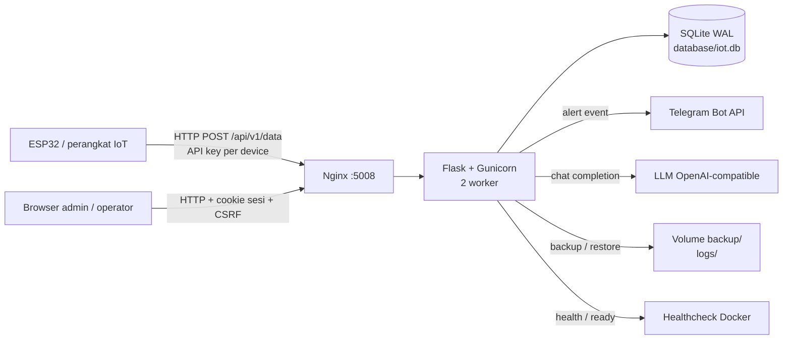

### 1.2 Prinsip desain yang terlihat dari kode

| Prinsip | Implementasi |
|---|---|
| Satu sumber kebenaran akses | `app/workspace.py` menghitung peran dan scope; UI hanya menyembunyikan kontrol |
| Dashboard = workspace | Setiap dashboard punya perangkat, anggota, widget, tab analitik, dan bot Telegram sendiri |
| Data perangkat tidak bocor | API perangkat hanya mengembalikan data dalam scope dashboard yang boleh diakses |
| API key tidak disimpan plaintext | Yang disimpan `api_key_hash` SHA-256; plaintext hanya muncul sekali saat create/regenerate |
| Background task tunggal | Hanya satu worker Gunicorn memegang `flock`; worker lain menjadi pengawas |
| Restore aman | Restore tidak menimpa DB hidup; disiapkan sebagai file pending dan diterapkan saat start |
| Audit aksi sensitif | `audit_log` mencatat delete, role change, permission change, backup, purge, vacuum, restore |

---

## 2. Arsitektur dan deployment

### 2.1 Topologi runtime

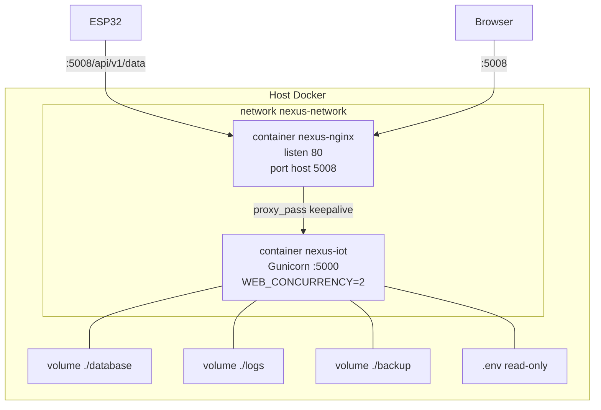

### 2.2 Pipeline request

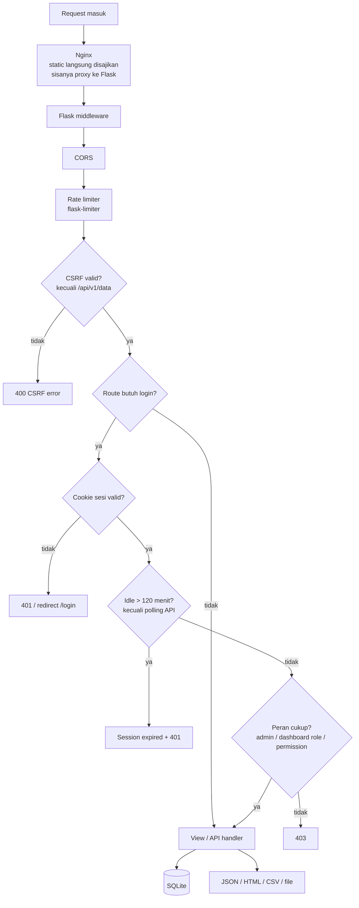

### 2.3 Detail deployment

| Komponen | Nilai |
|---|---|
| Port publik | `5008` (Nginx) |
| Port internal app | `5000` |
| Worker | `WEB_CONCURRENCY=2` |
| Static | Nginx `alias /static/`, cache 30 hari `immutable` |
| Healthcheck container | `GET /health` setiap 30 detik |
| Database | `./database/iot.db` (WAL) |
| Log | `./logs/nexus.log`, rotasi 10 MB × 5 |
| Backup | `./backup/iot_YYYYMMDD_HHMMSS.db` |
| Timezone aplikasi | WIB, `UTC+7`, disimpan sebagai datetime **naive** |
| Perintah produksi | `docker compose -f docker-compose.yml up -d` |

> Catatan: `docker-compose.override.yml` untuk development **tidak** ikut dipakai bila produksi dijalankan dengan `-f docker-compose.yml`.

---

## 3. Startup, konfigurasi, dan migrasi

### 3.1 Urutan startup aplikasi

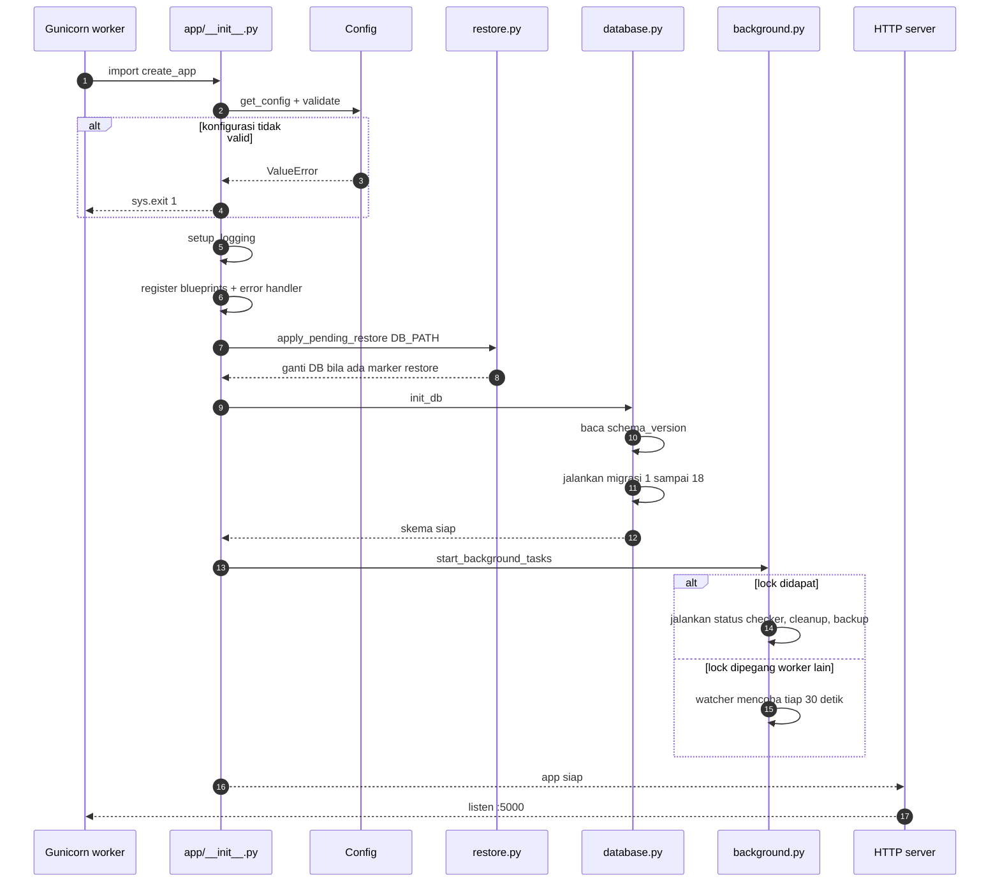

### 3.2 Alur migrasi skema

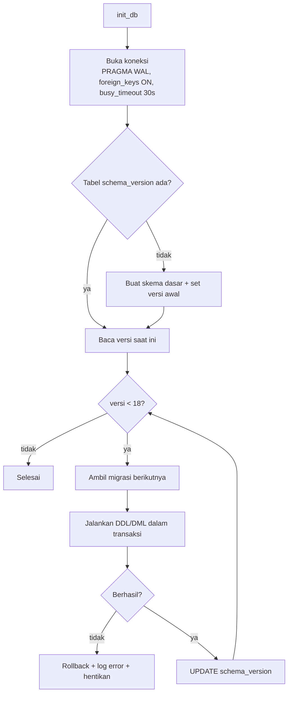

### 3.3 Kelompok konfigurasi penting

| Kelompok | Variabel | Default / perilaku |
|---|---|---|
| Inti | `SECRET_KEY`, `IOT_USERNAME`, `IOT_PASSWORD` | Wajib; seed admin pertama |
| Sesi | `SESSION_LIFETIME_HOURS`, `SESSION_IDLE_TIMEOUT_MINUTES` | 24 jam absolut, 120 menit idle |
| Cookie | `SESSION_COOKIE_SECURE`, `ENABLE_HSTS` | Secure mengikuti HSTS bila tidak di-set |
| CSRF | `WTF_CSRF_ENABLED` | `True`; hanya `/api/v1/data` exempt |
| Body | `MAX_CONTENT_LENGTH`, `DATA_MAX_BYTES` | 2 MB umum, 8 KB khusus ingest |
| Rate limit | `RATE_LIMIT_DEFAULT`, `RATE_LIMIT_DATA`, `RATE_LIMIT_DATA_IP` | 200/menit, 60/menit per device, 600/menit per IP |
| Login | `LOGIN_MAX_FAILURES`, `LOGIN_IP_MAX_FAILURES`, `LOGIN_LOCKOUT_SECONDS` | 5 gagal per user+IP, 20 gagal per IP, lock 15 menit |
| Offline | `OFFLINE_TIMEOUT`, `CHECK_INTERVAL` | 900 detik, cek tiap 60 detik |
| Retensi | `DATA_RETENTION_DAYS`, `ALERT_HISTORY_RETENTION_DAYS`, `STATUS_LOG_RETENTION_DAYS`, `ATTENDANCE_RETENTION_DAYS` | 30, 90, 30, 365 hari |
| Backup | `BACKUP_ENABLED`, `BACKUP_INTERVAL_HOURS`, `BACKUP_RETENTION_DAYS`, `BACKUP_MIN_KEEP` | aktif, 24 jam, 7 hari, minimal 3 file |
| Telegram | `TELEGRAM_ENABLED`, `TELEGRAM_BOT_TOKEN`, `TELEGRAM_CHAT_ID`, `TELEGRAM_TOKEN_KEY` | fallback bot global; token dashboard terenkripsi |
| Notifikasi | `NOTIFY_ENABLED`, `NOTIFY_MIN_SEVERITY`, `NOTIFY_ON_CLEARED` | hanya warning/danger, cleared ikut |
| LLM | `LLM_BASE_URL`, `LLM_API_KEY`, `LLM_MODEL`, `LLM_TIMEOUT` | chat nonaktif bila API key kosong |
| CORS | `CORS_ORIGINS` | default `http://localhost:5000` |
| Background | `BACKGROUND_TASKS_ENABLED` | `True` |

### 3.4 Seed admin pertama

Saat database kosong, `auth.py` membuat user dari `IOT_USERNAME` / `IOT_PASSWORD` dengan peran **superadmin**. User ini:

- tidak bisa dihapus,
- tidak bisa diturunkan perannya,
- hanya bisa dibuat ulang dengan menghapus database (bukan prosedur yang didukung).

---

## 4. Model data dan ERD

### 4.1 ERD

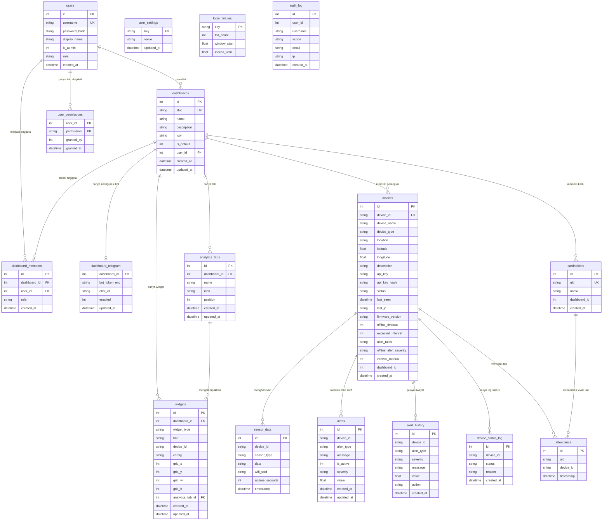

> Garis relasi di ERD adalah **relasi logis**. Hanya sebagian yang ditegakkan foreign key SQLite: `dashboard_members`, `analytics_tabs`, `widgets`, `dashboard_telegram`, dan `user_permissions`. Kolom `devices.dashboard_id`, `cardholders.dashboard_id`, `attendance.uid`, dan `audit_log.user_id` dijaga oleh kode aplikasi, bukan constraint database.

### 4.2 Kamus tabel

| Tabel | Fungsi | Catatan penting |
|---|---|---|
| `users` | Akun login | `is_admin` dan `role` harus konsisten; superadmin dilindungi |
| `dashboards` | Workspace | `slug` dijaga unik global oleh aplikasi; constraint DB `UNIQUE(user_id, slug)`; `is_default` per user dikelola aplikasi |
| `dashboard_members` | Anggota workspace | Role hanya `viewer` / `editor`; owner = `dashboards.user_id` |
| `dashboard_telegram` | Bot Telegram per dashboard | Token disimpan `enc:v1:` (Fernet) |
| `analytics_tabs` | Tab halaman Analitik | Urutan lewat `position` |
| `widgets` | Chart/widget | Bisa milik dashboard langsung atau tab analitik |
| `devices` | Master perangkat | `api_key_hash` untuk verifikasi; `api_key` legacy selalu `NULL` pada create baru |
| `sensor_data` | Time-series pembacaan sensor | `data` JSON; indeks utama `device_id, timestamp` |
| `alerts` | Alert aktif | Satu baris aktif per `device_id + alert_type` |
| `alert_history` | Jejak perubahan alert | `action`: `created`, `severity_changed`, `acknowledged`, `cleared` |
| `device_status_log` | Transisi online/offline | Alasan: `data_received`, `recovered`, `timeout_Ns`, `never_seen` |
| `attendance` | Tap kartu RFID | Dedup 30 detik per `uid + device_id` |
| `cardholders` | Master kartu | `uid` unik; `dashboard_id` tanpa FK |
| `user_permissions` | Izin eksplisit | Hanya `attendance.view`, `attendance.manage` |
| `user_settings` | KV internal | Global alert rules + heartbeat background |
| `login_failures` | Throttle login | Key `u:username|ip` dan `ip:ip` |
| `audit_log` | Audit aksi sensitif | Detail dipotong 2000 karakter |
| `schema_version` | Versi migrasi | Satu baris versi terakhir |

### 4.3 Indeks dan perilaku SQLite

- `PRAGMA journal_mode=WAL`, `synchronous=NORMAL`, `foreign_keys=ON`, `busy_timeout=30000`.
- `sensor_data` diindeks untuk query per device dan timestamp menurun.
- `alerts` diindeks untuk pencarian alert aktif per device/severity.
- `attendance` diindeks `uid, timestamp`.
- `devices.api_key_hash` diindeks untuk lookup autentikasi ingest.
- `dashboard_id` pada `devices` dan `cardholders` adalah **kolom biasa tanpa foreign key**, sehingga pemindahan/penghapusan harus dijaga aplikasi.

---

## 5. Autentikasi, sesi, CSRF, dan otorisasi

### 5.1 Alur login

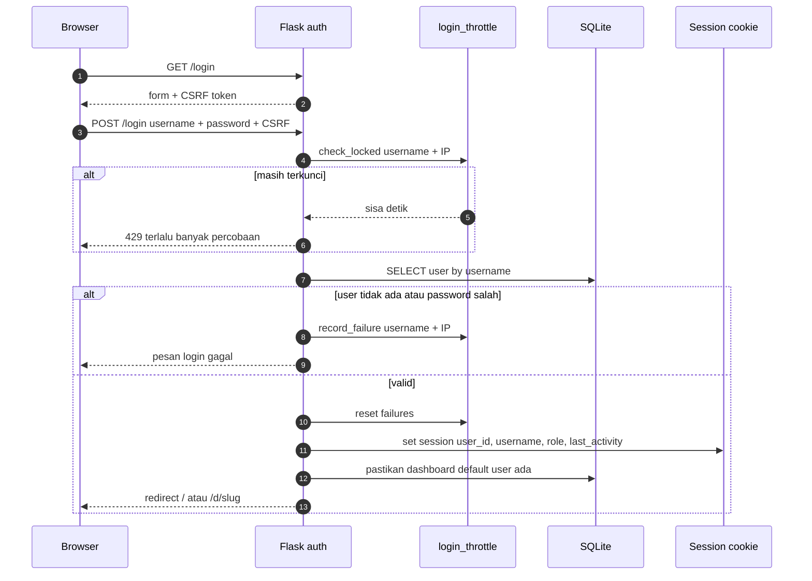

### 5.2 Pemeriksaan sesi setiap request

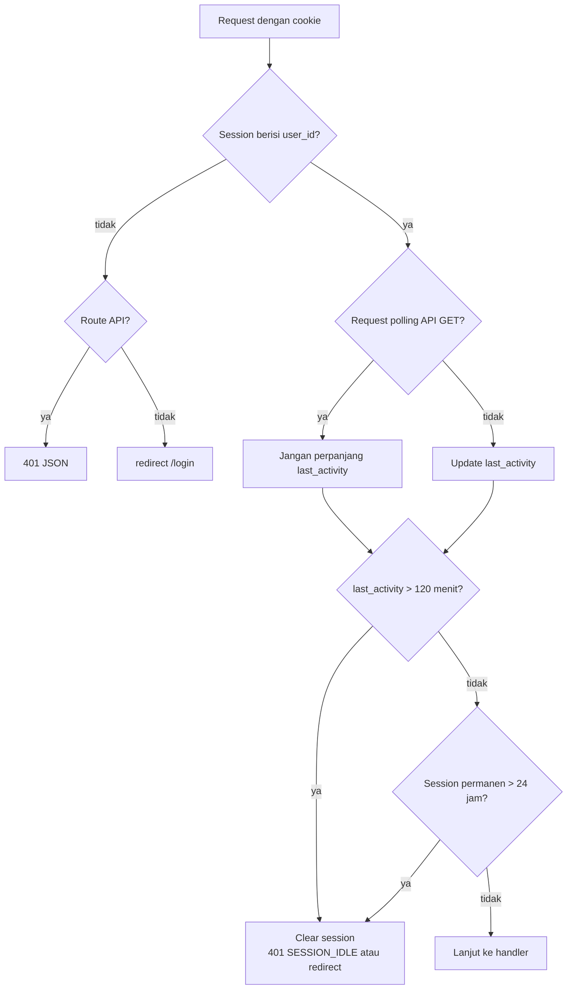

**Polling yang tidak memperpanjang sesi** adalah GET API dengan pola tertentu (dashboard, devices, alerts, attendance, metrics, system info, dsb). Tujuannya agar tab yang dibiarkan terbuka tetap logout karena idle.

### 5.3 Model peran

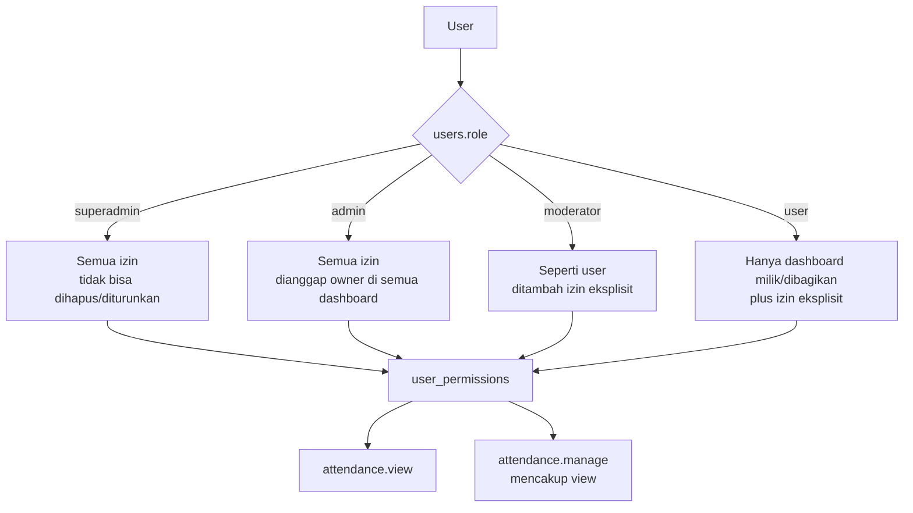

### 5.4 Peran per dashboard

| Peran | Sumber | Boleh |
|---|---|---|
| `owner` | `dashboards.user_id` | Semua: ubah/hapus dashboard, anggota, Telegram, widget, perangkat, kartu |
| `editor` | `dashboard_members.role` | Tambah/ubah/hapus perangkat, widget, tab, kartu; tidak boleh kelola anggota/Telegram/hapus dashboard |
| `viewer` | `dashboard_members.role` | Hanya melihat |
| admin | `users.is_admin=1` | Diperlakukan `owner` di semua dashboard |

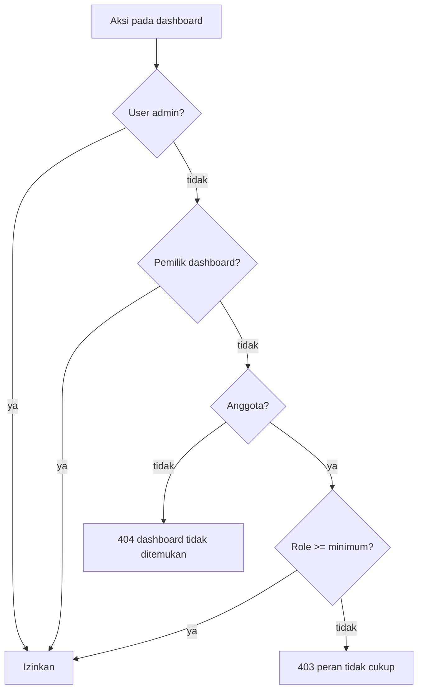

> Respons untuk dashboard yang tidak boleh diakses sengaja **404**, bukan 403, agar keberadaan dashboard tidak bocor.

### 5.5 CSRF dan sesi

- Token CSRF disematkan di `<meta name="csrf-token">` pada `base.html`.
- `static/js/api.js` menambahkan `X-CSRFToken` ke setiap request non-GET.
- Hanya endpoint perangkat `POST /api/v1/data` yang dikecualikan dari CSRF.
- Cookie: `HttpOnly=True`, `SameSite=Lax`, `Secure` mengikuti HSTS atau env.
- `SESSION_REFRESH_EACH_REQUEST=False`, sehingga cookie tidak diperbarui setiap request.

---

## 6. Workspace dan scope dashboard

### 6.1 Resolusi scope request

Frontend mengirim header `X-Dashboard-Id` (disisipkan otomatis oleh `api.js`) atau query `dashboard_id`.

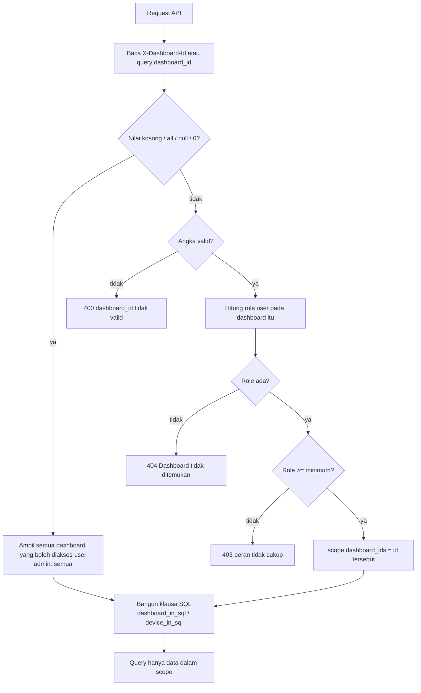

### 6.2 Ke mana perangkat baru diletakkan

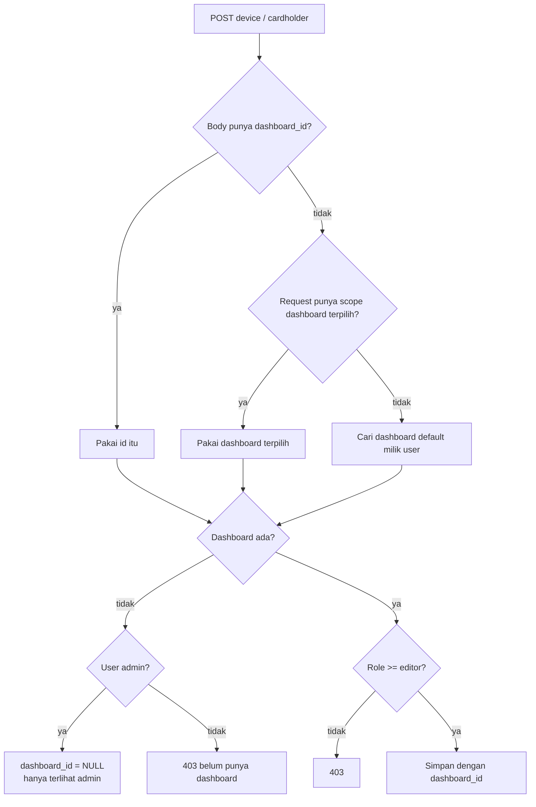

### 6.3 Lifecycle dashboard

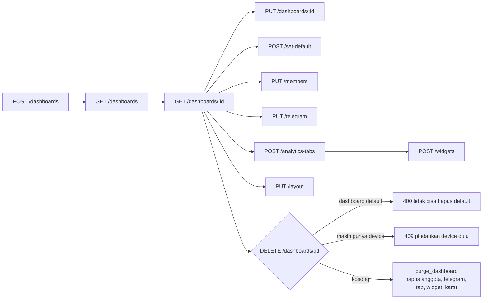

### 6.4 Anggota dan bot Telegram

- Menambah anggota: `PUT /dashboards/:id/members` dengan `user_id` dan `role` (`viewer`/`editor`).
- Owner tidak bisa ditambahkan sebagai member; owner adalah pemilik dashboard.
- Admin bisa mengelola semua member.
- Bot Telegram per dashboard disimpan di `dashboard_telegram`.
- Token dienkripsi Fernet dengan kunci turunan `TELEGRAM_TOKEN_KEY` atau `SECRET_KEY`.
- Bila dashboard punya konfigurasi Telegram tetapi `enabled=0`, notifikasi untuk perangkat dashboard itu **dimute** (tidak fallback ke bot global).
- Bila dashboard belum punya konfigurasi, notifikasi memakai bot global dari `.env`.

---

## 7. Siklus hidup perangkat

### 7.1 Menambah perangkat

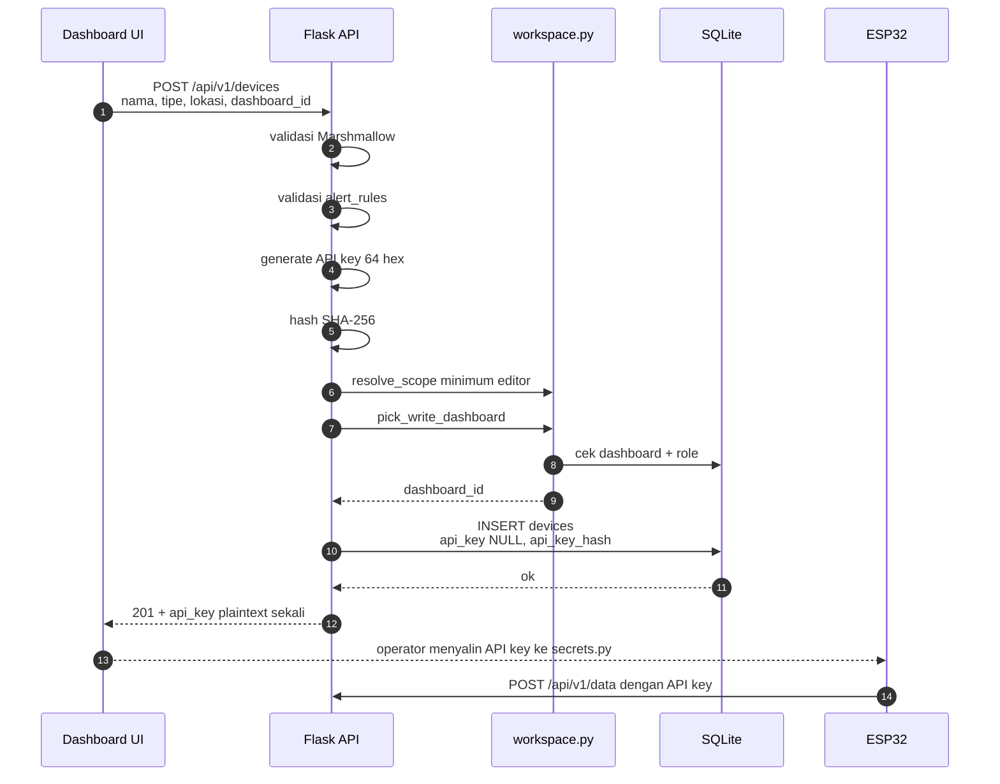

**Aturan pembuatan:**

| Field | Perilaku |
|---|---|
| `device_id` | Wajib, unik, hanya huruf/angka/dash/underscore, maks 64 |
| `device_name` | Wajib, maks 128 |
| `device_type` | Default `ESP32`; bila mengandung `rfid`, offline timeout default 86400 detik |
| `expected_interval` | Bila diisi eksplisit → mode manual (`interval_manual=1`); bila tidak → auto-detect |
| `offline_timeout` | Bila kosong → otomatis 2× interval, fallback 900 detik |
| `offline_alert_severity` | `info`, `warning`, `danger`; default `danger` |
| `alert_rules` | Override global per sensor; divalidasi sebelum disimpan |
| `api_key` | Hanya dikembalikan sekali; tidak bisa dilihat lagi |

### 7.2 Mengubah perangkat

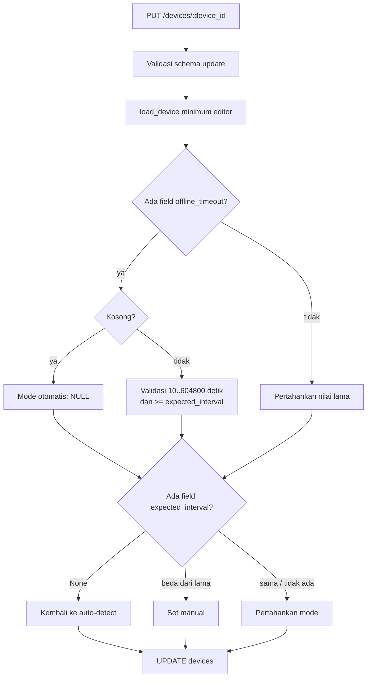

### 7.3 Menghapus perangkat

`DELETE /api/v1/devices/:device_id` melakukan cascade manual:

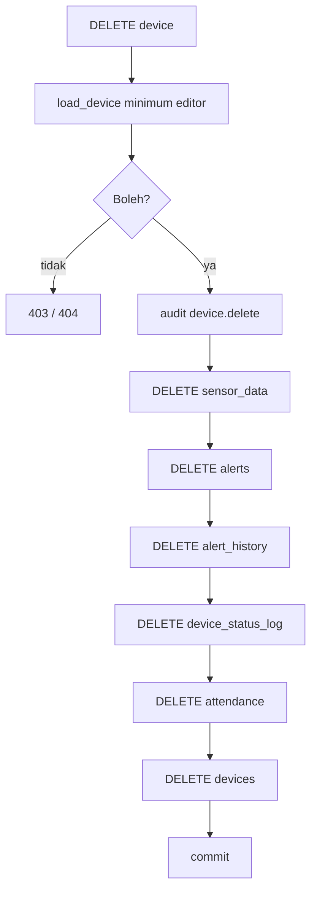

> Kartu (`cardholders`) **tidak** dihapus saat perangkat dihapus karena kartu milik dashboard, bukan perangkat.

### 7.4 Regenerate API key

`POST /api/v1/devices/:device_id/regenerate-key`

1. Cek peran editor.
2. Generate key baru.
3. Simpan hanya hash, kosongkan kolom `api_key`.
4. Kembalikan key plaintext sekali.
5. Firmware lama langsung gagal autentikasi sampai diperbarui.

### 7.5 Bulk import

`POST /api/v1/devices/bulk-import` — maksimal 200 perangkat per panggilan.

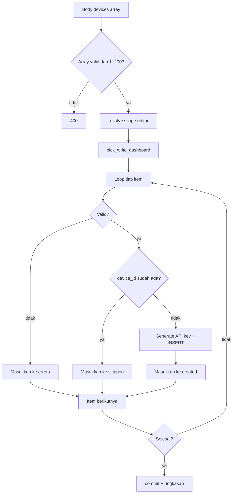

Bulk import **tidak** mendukung `expected_interval`, `alert_rules`, atau koordinat peta; field tersebut harus diisi lewat edit setelah import.

### 7.6 Export data perangkat

`GET /api/v1/devices/:device_id/export?format=csv|json&hours=24&limit=10000`

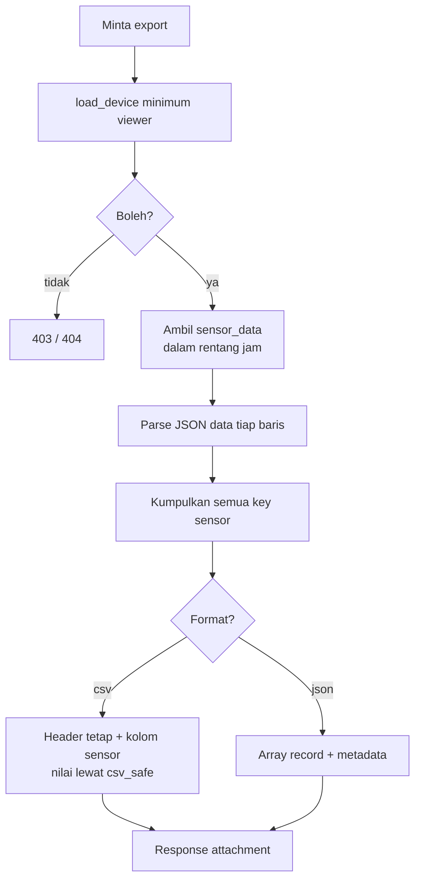

- `hours` maksimal 8760 (1 tahun), `limit` maksimal 50000.
- CSV menggabungkan key sensor yang berbeda menjadi kolom dinamis.
- Nilai string yang berpotensi formula diamankan `csv_safe()`.
- JSON menyertakan `device_id`, `device_name`, `exported_at`, `range_hours`, dan `count`.

### 7.7 Riwayat status perangkat

`GET /api/v1/devices/:device_id/status-history?limit=30` mengembalikan transisi `online`/`offline` dari `device_status_log`, termasuk `reason` seperti `data_received`, `recovered`, `timeout_Ns`, dan `never_seen`. Data ini dipakai untuk audit konektivitas dan grafik historis perangkat.

---

## 8. Ingest data dari ESP32

### 8.1 Urutan ingest

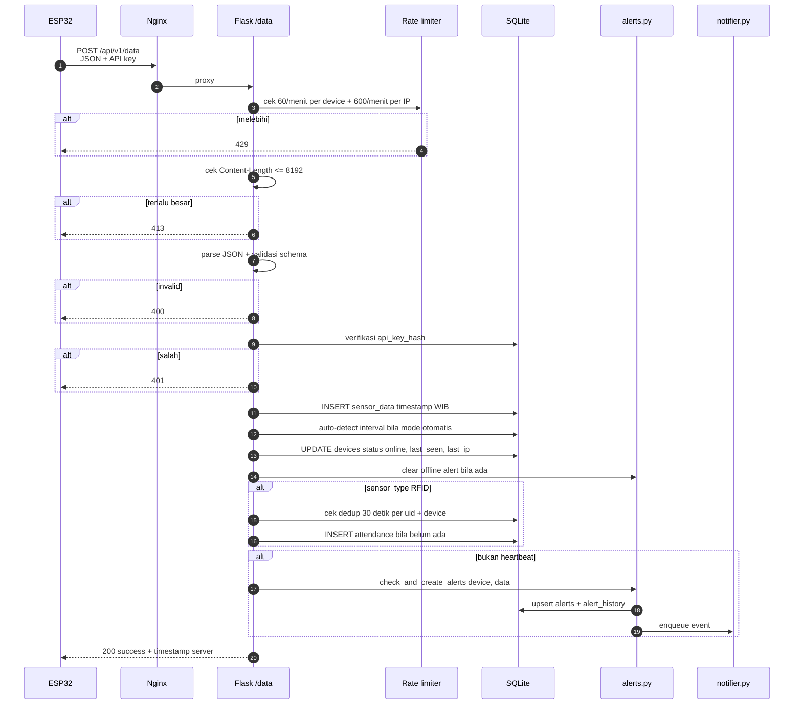

### 8.2 Validasi ingest

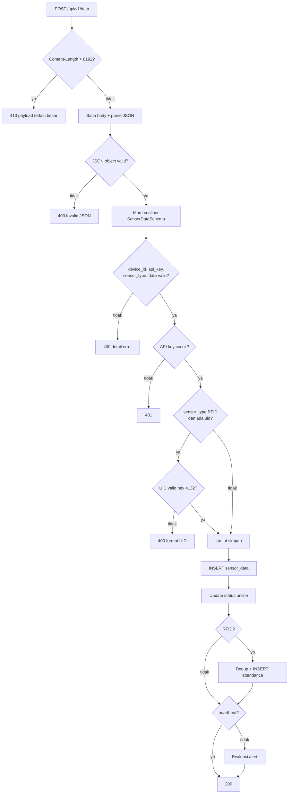

### 8.3 Format payload

```json
{
  "device_id": "esp32-01",
  "api_key": "64_hex_character_key",
  "sensor_type": "DHT22",
  "wifi_ssid": "Lab",
  "uptime_seconds": 1234,
  "data": {
    "temperature": 27.4,
    "humidity": 61.2
  }
}
```

Aturan `data`:

- Harus object datar.
- Maksimal 32 key.
- Key hanya huruf/angka/underscore, 1–32 karakter.
- Nilai boleh angka finite, boolean, atau string pendek (maks 64 karakter).
- Object/array bersarang ditolak.

### 8.4 Auto-detect interval

```mermaid
flowchart TD
    A["Data baru tersimpan"] --> B{"interval_manual = 1?"}
    B -->|"ya"| Z["Tidak mengubah expected_interval"]
    B -->|"tidak"| C["Ambil 10 timestamp terakhir"]
    C --> D{"Sampel >= 10?"}
    D -->|"tidak"| Z
    D -->|"ya"| E["Hitung selisih antar timestamp<br/>abaikan < 2 detik"]
    E --> F{"Selisih valid >= 3?"}
    F -->|"tidak"| Z
    F -->|"ya"| G["Median selisih"]
    G --> H["Clamp 10..86400 detik"]
    H --> I{"Beda > 20% dari nilai lama<br/>atau belum ada nilai?"}
    I -->|"tidak"| Z
    I -->|"ya"| J["UPDATE expected_interval"]
```

Interval hasil auto-detect dipakai untuk menghitung offline timeout otomatis (2× interval).

### 8.5 RFID dan dedup

```mermaid
sequenceDiagram
    autonumber
    participant R as Reader RFID
    participant F as Flask
    participant DB as SQLite

    R->>F: POST /data sensor_type=RFID, data.uid
    F->>F: normalisasi UID
    F->>DB: INSERT sensor_data
    F->>DB: SELECT attendance terakhir<br/>uid sama + device sama dalam 30 detik
    alt ditemukan
        F-->>R: 200 tanpa insert attendance
    else belum ada
        F->>DB: INSERT attendance uid, device, timestamp
        F-->>R: 200
    end
    F->>F: evaluasi alert selain uid
```

Dedup mencegah satu tap tertulis berkali-kali saat reader mengirim ulang dalam loop cepat. Dedup **per uid + per device**, jadi kartu yang sama di reader berbeda tetap tercatat.

---

## 9. Mesin alert dan notifikasi

### 9.1 Sumber aturan alert

```mermaid
flowchart TD
    A["check_and_create_alerts"] --> B["Baca global rules<br/>config.ALERT_RULES"]
    B --> C["Overlay user_settings.global_alert_rules<br/>cache 45 detik"]
    C --> D["Baca devices.alert_rules"]
    D --> E{"Rule per sensor valid?"}
    E -->|"tidak"| F["Abaikan, pakai global"]
    E -->|"ya"| G["Override global per sensor"]
    F --> H["Set aturan final"]
    G --> H
    H --> I["Untuk tiap key numerik di data"]
    I --> J{"Key punya rule?"}
    J -->|"tidak"| K["Lewati"]
    J -->|"ya"| L["Evaluasi severity"]
```

Aturan global disimpan di `user_settings` dengan key `global_alert_rules`, di-cache 45 detik, dan di-invalidate saat admin mengubahnya.

### 9.2 State machine alert

```mermaid
stateDiagram-v2
    [*] --> Healthy
    Healthy --> Warning : nilai masuk rentang warning
    Healthy --> Danger : nilai masuk rentang danger
    Warning --> Danger : kondisi memburuk
    Danger --> Warning : kondisi membaik melewati hysteresis
    Warning --> Healthy : nilai kembali normal
    Danger --> Healthy : nilai kembali normal
    Warning --> Warning : nilai berubah dalam rentang sama
    Danger --> Danger : nilai berubah dalam rentang sama

    note right of Warning
        Histeresis 0.5 mencegah alert berkedip
        di batas rentang. Penurunan severity
        hanya diterima bila nilai masuk
        rentang baru dengan margin offset.
    end note
```

### 9.3 Keputusan saat data masuk

```mermaid
flowchart TD
    A["Nilai sensor"] --> B["Tentukan severity dari rentang"]
    B --> C{"Ada alert aktif<br/>device + sensor?"}
    C -->|"ya"| D["Terapkan hysteresis<br/>terhadap severity lama"]
    C -->|"tidak"| D
    D --> E{"Severity final healthy?"}
    E -->|"ya"| F{"Ada alert aktif?"}
    F -->|"ya"| G["Tutup alert<br/>log cleared<br/>kirim notifikasi clear"]
    F -->|"tidak"| H["Log implicit cleared<br/>bila sebelumnya acknowledged"]
    E -->|"tidak"| I{"Ada alert aktif?"}
    I -->|"ya"| J{"Severity berubah?"}
    J -->|"ya"| K["Update severity + message<br/>log severity_changed<br/>kirim notifikasi"]
    J -->|"tidak"| L["Update message + value<br/>tanpa notifikasi"]
    I -->|"tidak"| M{"Harus skip?<br/>ack severity >= baru"}
    M -->|"ya"| N["Skip"]
    M -->|"tidak"| O["INSERT alert aktif<br/>log created<br/>kirim notifikasi"]
```

### 9.4 Aturan acknowledge

```mermaid
flowchart TD
    A["User acknowledge alert"] --> B["Validasi scope device"]
    B --> C{"Alert ditemukan?"}
    C -->|"tidak"| D["404"]
    C -->|"ya"| E["Set is_active = 0"]
    E --> F["Log history action acknowledged<br/>dengan severity saat ini"]
    F --> G["Ack hanya meredam alert<br/>dengan severity <= severity ack"]
    G --> H{"Data berikutnya lebih buruk?"}
    H -->|"ya"| I["Alert baru tetap dibuat"]
    H -->|"tidak"| J["Tidak ada alert baru"]
```

Ack **tidak** menghapus riwayat dan tidak mematikan evaluasi. Jika kondisi memburuk (mis. warning → danger), alert baru tetap muncul.

Endpoint ack menerima `id` dari tabel `alerts`, tetapi juga memiliki fallback ke `alert_history.id` untuk kompatibilitas frontend lama.

### 9.5 Deteksi offline

```mermaid
flowchart TD
    A["Status checker tiap 60 detik"] --> B["Ambil semua device"]
    B --> C{"last_seen ada?"}
    C -->|"tidak"| D{"Status sudah offline?"}
    D -->|"tidak"| E["Set offline<br/>log never_seen"]
    D -->|"ya"| F["Lewati"]
    C -->|"ya"| G["Hitung timeout efektif"]
    G --> H{"offline_timeout manual?"}
    H -->|"ya"| I["Pakai nilai manual"]
    H -->|"tidak"| J{"expected_interval ada?"}
    J -->|"ya"| K["2 × interval, minimal 10 detik"]
    J -->|"tidak"| L["Fallback 900 detik"]
    I --> M["time_diff = sekarang - last_seen"]
    K --> M
    L --> M
    M --> N{"time_diff > timeout?"}
    N -->|"ya"| O{"Status sudah offline?"}
    O -->|"tidak"| P["Set offline + log timeout<br/>buat offline alert"]
    O -->|"ya"| Q{"Sudah pernah alert<br/>sejak last_seen?"}
    Q -->|"tidak"| P
    Q -->|"ya"| R["Tidak buat ulang"]
    N -->|"tidak"| S{"Status offline?"}
    S -->|"ya"| T["Set online + log recovered<br/>clear offline alert"]
    S -->|"tidak"| U["Tidak berubah"]
```

Keterlambatan deteksi offline maksimal sekitar **satu interval checker (60 detik)** setelah timeout terlewati.

### 9.6 Notifikasi Telegram

```mermaid
sequenceDiagram
    autonumber
    participant A as alerts.py
    participant N as notifier.py
    participant Q as Queue max 1000
    participant W as Worker thread
    participant DB as SQLite
    participant T as Telegram API

    A->>N: notify_alert_event event
    N->>N: cek NOTIFY_ENABLED + severity minimum
    N->>N: cek dedup hash 60 detik
    N->>DB: resolve target dashboard
    alt dashboard punya bot aktif
        DB-->>N: token + chat_id dashboard
    else dashboard punya config tapi disabled
        N-->>N: mute, tidak kirim
    else tidak ada config
        N-->>N: pakai bot global .env
    end
    N->>Q: put event + target
    W->>Q: get
    W->>T: sendMessage HTML
    alt 429
        T-->>W: retry_after
        W->>W: sleep lalu retry maks 3
    else 5xx / network error
        W->>W: exponential backoff maks 3
    else HTML ditolak
        W->>T: kirim ulang teks polos
    end
    W->>Q: task_done
```

Aturan tampilan pesan:

- Pesan alert **tidak** mengulang nilai aktual di teks (nilai sudah jadi badge di UI).
- Pesan recovery menyertakan nilai akhir.
- Emoji dan label severity: `info`, `warning`, `danger`, `healthy`.
- Event `cleared` hanya dikirim bila `NOTIFY_ON_CLEARED=True`.

---

## 10. Dashboard dan antarmuka web

### 10.1 Boot halaman dashboard

```mermaid
sequenceDiagram
    autonumber
    participant B as Browser
    participant V as Flask view
    participant T as Template
    participant JS as dashboard.js
    participant API as API

    B->>V: GET / atau /d/slug
    V->>V: login_required + cari dashboard default
    V->>T: render dashboard.html<br/>dashboard_id, slug, is_admin
    T-->>B: HTML + meta csrf, dashboard-id
    B->>JS: load api.js, theme.js, ui.js, dashboard.js
    JS->>JS: baca meta + hash + localStorage
    JS->>API: GET /users/me
    JS->>API: GET /dashboards
    JS->>API: GET /dashboard
    JS->>API: GET /dashboards/:id/analytics-tabs
    JS->>JS: showSection dari hash
    JS->>JS: set interval 30 detik loadDashboard
    JS->>JS: set interval 15 detik refresh chart
    JS->>JS: set interval 60 detik activity feed
```

### 10.2 Routing section

Section yang tersedia: `dashboard`, `map`, `graph`, `attendance`, `devices`, `alerts`, `settings`.

```mermaid
flowchart TD
    A["Hash berubah / klik sidebar"] --> B["getSectionFromHash"]
    B --> C{"Section valid?"}
    C -->|"tidak"| D["dashboard"]
    C -->|"ya"| E{"attendance dan izin view?"}
    E -->|"tidak"| F["Tolak + kembali dashboard"]
    E -->|"ya"| G["Sembunyikan semua section<br/>tampilkan section aktif"]
    G --> H{"Section?"}
    H -->|"dashboard"| I["loadActivityFeed<br/>invalidate map preview"]
    H -->|"map"| J["init full map<br/>load markers"]
    H -->|"graph"| K["load tabs + refresh charts"]
    H -->|"attendance"| L["loadAttendance<br/>mulai polling 5 detik"]
    H -->|"devices"| M["render device table"]
    H -->|"alerts"| N["NexusAlerts.load"]
    H -->|"settings"| O["NexusSettings.show tab"]
    G --> P["simpan section ke sessionStorage"]
```

### 10.3 Polling dan interval frontend

| Interval | Fungsi | Catatan |
|---|---|---|
| 1 detik | Jam tanggal | Hanya teks, tanpa API |
| 5 detik | Absensi | Hanya saat section attendance aktif |
| 15 detik | Refresh chart | Hanya saat section graph terlihat |
| 30 detik | `GET /dashboard` | Ringkasan + daftar perangkat |
| 30 detik | `GET /chat/health` | Hanya saat panel chat terbuka |
| 60 detik | Activity feed | Hanya saat section dashboard |
| 30 detik | Mobile dashboard | Halaman `/mobile` punya loop sendiri |

Polling **tidak** memperpanjang sesi idle.

### 10.4 Alur data dashboard utama

```mermaid
flowchart LR
    A["GET /api/v1/dashboard"] --> B["resolve_scope"]
    B --> C["Hitung total, online, offline"]
    C --> D["Hitung alert aktif per severity"]
    D --> E["Join latest sensor_data per device"]
    E --> F["Join top alert per device"]
    F --> G["Susun device_list + summary"]
    G --> H["UI metric cards"]
    G --> I["Tabel perangkat"]
    G --> J["Marker peta"]
    G --> K["Activity feed"]
```

`GET /dashboard` mengembalikan:

- `summary.total_devices`, `online_devices`, `offline_devices`, `healthy_devices`, `active_alerts`, `danger_alerts`, `warning_alerts`, `info_alerts`.
- `devices[]` berisi info perangkat, data sensor terakhir, alert teratas, dan jumlah alert aktif.

### 10.5 Widget analitik

```mermaid
sequenceDiagram
    autonumber
    participant U as User
    participant UI as graph section
    participant API as API
    participant DB as SQLite

    U->>UI: buka tab Analitik
    UI->>API: GET /dashboards/:id/analytics-tabs
    API-->>UI: daftar tab
    UI->>API: GET /dashboards/:id/analytics-tabs/:tab/widgets
    API-->>UI: widget + config
    UI->>API: GET /devices/:id/history?hours=...
    API->>DB: SELECT sensor_data
    DB-->>API: time-series
    API-->>UI: history
    UI->>UI: Chart.js render
    U->>UI: ubah time range
    UI->>UI: simpan pilihan ke localStorage
    UI->>API: refresh data
    U->>UI: drag/resize widget
    UI->>API: PUT /dashboards/:id/layout
```

Widget disimpan di `widgets` dengan `widget_type`, `config` JSON, dan posisi grid. Tipe yang diakui: line, bar, area, doughnut, pie, polar area, radar, horizontal bar, stacked bar, stacked area.

### 10.6 Peta

- Leaflet + marker cluster.
- Koordinat diambil dari `devices.latitude/longitude`.
- Marker warna mengikuti status/alert.
- Ada peta preview di dashboard dan peta penuh di section `map`.
- Edit koordinat lewat modal perangkat, disimpan dengan `PUT /devices/:id`.

### 10.7 Halaman mobile

`/mobile` memakai `mobile.js` yang terpisah dari `dashboard.js`.

```mermaid
flowchart TD
    A["GET /mobile"] --> B["render mobile.html"]
    B --> C["loadDashboard tiap 30 detik"]
    C --> D["GET /dashboard"]
    D --> E["Kartu ringkasan + daftar"]
    E --> F{"Aksi user"}
    F -->|"tap device"| G["openDevice"]
    F -->|"edit"| H["modal edit + PUT device"]
    F -->|"hapus"| I["konfirmasi + DELETE device"]
    F -->|"tambah"| J["modal tambah + POST device"]
    G --> K["GET /devices/:id + history"]
```

Mobile memiliki alur dan state sendiri. Perubahan pada `dashboard.js` belum tentu tercermin di `mobile.js`.

### 10.8 LocalStorage / SessionStorage

| Key | Isi |
|---|---|
| `nexus-theme` | `dark` / `light` |
| `nexus-global-time` | Rentang waktu chart (menit) |
| `nexus-last-section` | Section terakhir |
| `nexus-current-tab` | Tab analitik terakhir |
| `nexus-chart-layout-*` | Layout chart |
| `nexus-chart-canvas-height` | Tinggi canvas |
| `nexus-chat-open` | Panel chat terbuka |
| `nexus_back_url` | URL kembali dari halaman detail |
| `nexus-alerts-*` | Preferensi alert |

---

## 11. Absensi dan RFID

### 11.1 Alur tap sampai laporan

```mermaid
sequenceDiagram
    autonumber
    participant K as Kartu RFID
    participant R as Reader ESP32
    participant F as Flask /data
    participant DB as SQLite
    participant UI as Halaman Absensi

    K->>R: tap
    R->>F: POST /data sensor_type=RFID uid
    F->>DB: INSERT sensor_data
    F->>DB: cek dedup 30 detik
    F->>DB: INSERT attendance
    F-->>R: 200
    UI->>F: GET /attendance?limit=100
    F->>DB: JOIN cardholders by uid
    DB-->>F: nama atau Tidak dikenal
    F-->>UI: daftar tap
    UI->>F: GET /attendance/stats
    UI->>F: GET /attendance/today
    UI->>F: GET /attendance/unregistered
```

### 11.2 Kartu dan izin

| Aksi | Endpoint | Izin |
|---|---|---|
| Lihat daftar kartu | `GET /cardholders` | `attendance.view` |
| Tambah kartu | `POST /cardholders` | `attendance.manage` |
| Hapus kartu | `DELETE /cardholders/:uid` | `attendance.manage` + role editor pada dashboard pemilik |
| Lihat absensi | `GET /attendance` | `attendance.view` |
| Laporan harian | `GET /attendance/report` | `attendance.view` |
| Statistik | `GET /attendance/stats` | `attendance.view` |
| Hari ini | `GET /attendance/today` | `attendance.view` |
| Kartu belum terdaftar | `GET /attendance/unregistered` | `attendance.view` |
| Tap asing terakhir | `GET /attendance/last-unknown` | `attendance.view` |
| Export CSV | `GET /attendance/export` | `attendance.view` |
| Sparkline | `GET /metrics/attendance-history` | `attendance.view` |

### 11.3 Laporan absensi

```mermaid
flowchart TD
    A["GET /attendance/report"] --> B["Filter start, end, uid"]
    B --> C["GROUP BY hari + uid"]
    C --> D["MIN timestamp = check_in"]
    C --> E["MAX timestamp = check_out"]
    C --> F["COUNT = total_taps"]
    D --> G["Hitung durasi"]
    E --> G
    F --> H["Susun report"]
    G --> H
    H --> I["UI tabel + export CSV"]
```

- `check_in` dan `check_out` adalah tap pertama dan terakhir pada hari itu, bukan aturan shift.
- Bila hanya satu tap, durasi `-`.
- Export memakai `csv_safe()` untuk mencegah formula injection.

### 11.4 Kartu tidak dikenal

Tap dengan UID yang belum ada di `cardholders` tetap disimpan di `attendance`. UI menampilkan nama **“Tidak dikenal”** dan menyediakan:

- daftar kartu belum terdaftar,
- tap asing terakhir,
- tombol untuk mendaftarkan UID tersebut sebagai cardholder.

---

## 12. Pengguna, peran, dan izin

### 12.1 Alur manajemen pengguna

```mermaid
flowchart TD
    A["Admin buka Settings / Pengguna"] --> B["GET /users"]
    B --> C{"Aksi"}
    C -->|"tambah"| D["POST /users"]
    C -->|"edit"| E["PUT /users/:id"]
    C -->|"hapus"| F["DELETE /users/:id"]
    C -->|"izin"| G["PUT /users/:id/permissions"]
    D --> D1{"Minta role admin?"}
    D1 -->|"ya"| D2{"Caller superadmin?"}
    D2 -->|"tidak"| D3["403"]
    D2 -->|"ya"| D4["Buat admin"]
    D1 -->|"tidak"| D5["Buat user/moderator"]
    E --> E1{"Target superadmin?"}
    E1 -->|"ya"| E2["403 tidak bisa diubah"]
    E1 -->|"tidak"| E3{"Ganti role sendiri?"}
    E3 -->|"ya"| E4["403"]
    E3 -->|"tidak"| E5["Validasi + update"]
    F --> F1{"Target diri sendiri?"}
    F1 -->|"ya"| F2["400"]
    F1 -->|"tidak"| F3{"Target superadmin?"}
    F3 -->|"ya"| F4["403"]
    F3 -->|"tidak"| F5["Pindahkan device/kartu<br/>ke dashboard admin<br/>lalu hapus"]
    G --> G1{"Target admin/superadmin?"}
    G1 -->|"ya"| G2["400 sudah punya semua izin"]
    G1 -->|"tidak"| G3["Set attendance.view/manage"]
```

### 12.2 Menghapus user

Perangkat dan kartu milik user yang dihapus **tidak ikut hilang**:

1. Cari semua dashboard milik user.
2. Pindahkan `devices.dashboard_id` ke dashboard default admin yang melakukan penghapusan.
3. Pindahkan `cardholders.dashboard_id` dengan cara yang sama.
4. `purge_dashboard()` untuk setiap dashboard user (anggota, Telegram, tab, widget).
5. Hapus keanggotaan user di dashboard lain.
6. Hapus user.
7. Catat audit `user.delete`.

### 12.3 Mengubah password sendiri

```mermaid
sequenceDiagram
    autonumber
    participant U as User
    participant F as Flask
    participant DB as SQLite

    U->>F: POST /users/me/password<br/>old_password, new_password
    F->>F: cek login + rate limit 10/menit
    F->>F: validasi panjang >= 8 dan beda dari lama
    F->>DB: SELECT password_hash
    F->>F: check_password_hash old
    alt salah
        F-->>U: 400 password lama salah
    else benar
        F->>DB: UPDATE password_hash = scrypt baru
        F-->>U: 200 sukses
    end
```

Password baru tidak memaksa logout sesi lain; sesi yang ada tetap valid sampai idle/absolut habis. Perubahan password hanya dicatat di log server, bukan di `audit_log`.

### 12.4 Aturan peran yang dijaga backend

- Hanya **superadmin** yang bisa memberi peran `admin`.
- Admin biasa tidak bisa mengubah/menghapus admin lain.
- Superadmin tidak bisa dihapus atau diturunkan.
- Admin terakhir tidak bisa dihapus/diturunkan.
- User tidak bisa mengubah peran sendiri.
- `users.is_admin` dan `users.role` selalu disinkronkan oleh `set_role()`.

---

## 13. Pengaturan dan administrasi sistem

### 13.1 Tab Settings

```mermaid
flowchart TD
    A["#settings"] --> B["Settings.show tab"]
    B --> C{"Tab"}
    C -->|"umum"| D["Preferensi tampilan / waktu"]
    C -->|"notifikasi"| E["Status Telegram + tes"]
    C -->|"alert-rules"| F["Global alert rules<br/>admin"]
    C -->|"pengguna"| G["User manager<br/>admin"]
    C -->|"data"| H["Cleanup, purge, vacuum, backup<br/>admin"]
    C -->|"impor"| I["Bulk import device<br/>admin"]
    C -->|"sistem"| J["Info sistem, backup, restore<br/>admin"]
```

Tab admin disembunyikan dengan `data-needs="admin"` dan tetap dijaga endpoint `@admin_required`.

### 13.2 Global alert rules

```mermaid
sequenceDiagram
    autonumber
    participant A as Admin
    participant F as Flask
    participant DB as SQLite
    participant C as Cache

    A->>F: GET /system/alert-rules
    F->>DB: baca config + user_settings
    F-->>A: rules efektif
    A->>F: PUT /system/alert-rules
    F->>F: validasi tiap sensor dan rentang
    F->>DB: simpan JSON global_alert_rules
    F->>C: invalidate cache
    F->>F: log server
    F-->>A: 200
    A->>F: DELETE /system/alert-rules
    F->>DB: hapus override
    F->>C: invalidate cache
    F-->>A: kembali ke default config
```

### 13.3 Info sistem dan health

| Endpoint | Isi |
|---|---|
| `GET /health` | Status DB, timestamp, versi; `503` bila DB gagal |
| `GET /ready` | `{"status":"ready"}` |
| `GET /system/info` | Versi, jumlah device/data/alert/attendance, ukuran DB, retensi, status background |

`/system/info` menghormati scope dashboard dan izin `attendance.view`; angka absensi tidak dikembalikan bila user tidak punya izin.

### 13.4 Audit log

Aksi yang dicatat antara lain:

| Action | Pemicu |
|---|---|
| `device.delete` | Hapus perangkat |
| `user.create` | Buat user |
| `user.role` | Ubah peran |
| `user.delete` | Hapus user |
| `user.permissions` | Ubah izin |
| `dashboard.member.set` | Tambah/ubah anggota dashboard |
| `dashboard.member.remove` | Hapus anggota dashboard |
| `dashboard.telegram.set` / `dashboard.telegram.delete` | Ubah/hapus bot dashboard |
| `data.cleanup_retention` | Cleanup manual |
| `data.delete` | Purge per rentang |
| `db.vacuum` | VACUUM |
| `backup.delete` | Hapus file backup |
| `dashboard.delete` | Hapus dashboard |

`GET /system/audit-log?limit=50` hanya untuk admin, maksimal 500 entri.

> Beberapa aksi sensitif lain hanya dicatat di log server, bukan `audit_log`: ganti password, ubah global alert rules, jadwalkan restore, dan backup manual.

---

## 14. Backup, restore, cleanup, dan purge

### 14.1 Backup otomatis dan manual

```mermaid
sequenceDiagram
    autonumber
    participant BG as background backup
    participant DB as SQLite
    participant FS as backup/
    participant API as Flask API
    participant AD as Admin

    BG->>BG: tunggu 30 detik setelah boot
    BG->>BG: cek backup terbaru<br/>jatuh tempo?
    alt belum jatuh tempo
        BG->>BG: tidur sampai jatuh tempo
    else jatuh tempo
        BG->>DB: sqlite backup API
        DB-->>FS: iot_YYYYMMDD_HHMMSS.db
        BG->>FS: prune iot_*.db<br/>retensi 7 hari, min 3
    end
    AD->>API: POST /system/backup
    API->>DB: sqlite backup API
    DB-->>FS: iot_YYYYMMDD_HHMMSS.db
    API-->>AD: filename + size
```

Aturan prune:

- Hanya file `iot_*.db` yang boleh dihapus otomatis.
- `pre-restore-*.db` dan `pre-delete_*.db` tidak pernah disentuh.
- Minimal `BACKUP_MIN_KEEP` backup terbaru selalu disimpan.

### 14.2 Restore

```mermaid
sequenceDiagram
    autonumber
    participant AD as Admin
    participant API as Flask
    participant FS as backup/
    participant DB as SQLite
    participant APP as Startup

    AD->>API: POST /system/restore<br/>filename + confirm=RESTORE
    API->>API: validasi nama file + path traversal
    API->>DB: PRAGMA integrity_check file backup
    alt corrupt
        API-->>AD: 400
    end
    API->>DB: backup DB saat ini
    DB-->>FS: pre-restore-YYYYMMDD_HHMMSS.db
    API->>FS: salin backup ke iot.db.restore-pending
    API->>FS: tulis iot.db.restore-marker
    API-->>AD: 200 restart_required
    AD->>APP: restart container
    APP->>FS: baca marker
    APP->>FS: hapus -wal dan -shm
    APP->>FS: ganti iot.db dengan pending
    APP->>FS: hapus marker + pending
    APP->>APP: init_db + migrate bila perlu
```

Restore **tidak pernah** menimpa database yang sedang hidup. Ini mencegah korupsi saat masih ada koneksi WAL aktif.

### 14.3 Cleanup retensi

```mermaid
flowchart TD
    A["Cleanup otomatis tiap 24 jam<br/>atau POST /system/cleanup"] --> B["Hitung cutoff per tabel"]
    B --> C["sensor_data < DATA_RETENTION_DAYS"]
    B --> D["alert_history < ALERT_HISTORY_RETENTION_DAYS"]
    B --> E["device_status_log < STATUS_LOG_RETENTION_DAYS"]
    B --> F["attendance < ATTENDANCE_RETENTION_DAYS"]
    B --> G["alerts tidak aktif < ALERT_HISTORY_RETENTION_DAYS"]
    C --> H["DELETE"]
    D --> H
    E --> H
    F --> H
    G --> H
    H --> I{"Total > 1000?"}
    I -->|"ya"| J["VACUUM"]
    I -->|"tidak"| K["Selesai"]
    J --> K
```

### 14.4 Purge per rentang

```mermaid
flowchart TD
    A["POST /system/data/preview"] --> B["Validasi tables, tanggal, device, dashboard"]
    B --> C{"Minimal satu batas tanggal?"}
    C -->|"tidak"| C1["400 hapus tanpa batas ditolak"]
    C -->|"ya"| D["Hitung baris + estimasi byte"]
    D --> E["Tampilkan pratinjau"]
    E --> F["POST /system/data/delete<br/>confirm=true"]
    F --> G{"backup_first?"}
    G -->|"ya"| H["Buat pre-delete_*.db"]
    G -->|"tidak"| I["Langsung"]
    H --> J["DELETE per batch 5000"]
    I --> J
    J --> K["commit per batch"]
    K --> L["Audit data.delete"]
    L --> M["Ringkasan deleted"]
```

Tabel yang bisa dipurge: `sensor_data`, `alert_history`, `device_status_log`, `attendance`, `alerts` tidak aktif.

### 14.5 VACUUM dan hapus backup

- `POST /system/vacuum` mengecek ruang disk minimal 1,2× ukuran DB; menolak `409` bila tidak cukup.
- `DELETE /system/backups/:filename` selalu melindungi backup terbaru (`409`).
- Nama file divalidasi `secure_filename`, harus `.db`, dan path harus di dalam `BACKUP_DIR`.

---

## 15. Chat AI

### 15.1 Status dan konfigurasi

Chat memakai endpoint OpenAI-compatible (`/chat/completions`). Chat **nonaktif** bila `LLM_API_KEY` kosong atau health check gagal.

```mermaid
flowchart TD
    A["Panel chat dibuka"] --> B["GET /chat/health"]
    B --> C{"LLM_API_KEY di-set?"}
    C -->|"tidak"| D["UI menampilkan chat nonaktif"]
    C -->|"ya"| E{"Health check OK?"}
    E -->|"tidak"| D
    E -->|"ya"| F["Input aktif"]
```

### 15.2 Alur tool calling

```mermaid
sequenceDiagram
    autonumber
    participant U as User
    participant UI as chat.js
    participant F as Flask /chat
    participant L as LLM
    participant DB as SQLite

    U->>UI: kirim pertanyaan
    UI->>F: POST /chat<br/>messages, files
    F->>F: sanitasi pesan<br/>maks 10 pesan, 4000 char
    F->>F: filter tool sesuai izin
    loop maks 3 putaran
        F->>L: chat completion + tools
        alt LLM minta tool
            L-->>F: tool_calls maks 5
            F->>DB: jalankan tool dalam scope
            DB-->>F: hasil
            F->>F: batasi 100 baris / 20 KB
        else jawaban final
            L-->>F: content
        end
    end
    F-->>UI: jawaban + file opsional
    UI->>UI: render markdown / unduh file
```

### 15.3 Tool yang tersedia

| Tool | Fungsi | Izin |
|---|---|---|
| `get_present_today` | Daftar hadir hari ini | `attendance.view` |
| `get_absent_today` | Daftar belum hadir | `attendance.view` |
| `get_attendance_range` | Absensi rentang tanggal | `attendance.view` |
| `get_cardholders` | Daftar kartu | `attendance.view` |
| `export_attendance_csv` | Buat file CSV absensi | `attendance.view` |
| `get_devices_status` | Status perangkat | login |
| `get_active_alerts` | Alert aktif | login |
| `get_device_history` | Riwayat sensor | login |
| `generate_bulk_template` | Template import perangkat | login |

Batas keamanan:

- Maksimal 3 putaran tool.
- Maksimal 5 tool call per putaran.
- Hasil tool maksimal 100 baris dan 20 KB.
- Hanya role `user` dan `assistant` yang diteruskan ke LLM.
- Tool absensi disembunyikan dari user tanpa izin.

> Catatan: export CSV dari chat **belum** memakai `csv_safe()`; lihat bagian known quirks.

---

## 16. Background tasks

### 16.1 Scheduler

```mermaid
flowchart TB
    START["start_background_tasks"] --> LOCK{"flock nexus-background.lock"}
    LOCK -->|"didapat"| SPAWN["Mulai 3 thread"]
    LOCK -->|"gagal"| WATCH["Watcher tiap 30 detik"]
    WATCH -->|"pemegang mati"| SPAWN
    SPAWN --> S1["status-checker<br/>tiap CHECK_INTERVAL 60s"]
    SPAWN --> S2["data-cleanup<br/>delay 5 menit, lalu 24 jam"]
    SPAWN --> S3["db-backup<br/>delay 30 detik, lalu interval"]
    S1 --> HB["heartbeat bg_hb_status_check"]
    S2 --> HB2["heartbeat bg_hb_cleanup"]
    S3 --> HB3["heartbeat bg_hb_backup"]
    HB --> INFO["GET /system/info"]
    HB2 --> INFO
    HB3 --> INFO
```

### 16.2 Mekanisme lock

```mermaid
stateDiagram-v2
    [*] --> MencariLock
    MencariLock --> Pemilik : flock berhasil
    MencariLock --> Menunggu : flock gagal
    Menunggu --> Pemilik : retry 30 detik berhasil
    Menunggu --> Menunggu : pemegang masih hidup
    Pemilik --> Berhenti : SIGTERM / shutdown
    Berhenti --> [*]
```

- Lock file default `/tmp/nexus-background.lock` (atau `NEXUS_LOCK_DIR`).
- Hanya satu proses yang menjalankan ketiga task.
- Worker lain tetap melayani request; mereka hanya tidak menjalankan background task.
- Heartbeat disimpan di `user_settings` dengan prefix `bg_hb_`; status dianggap stale bila lebih tua dari 3× interval.

### 16.3 Dampak ke operasi

| Task | Dampak bila mati | Cara cek |
|---|---|---|
| Status checker | Perangkat tidak berubah offline, alert offline tidak muncul | `system/info.background.last_status_check` |
| Cleanup | Data lama menumpuk, DB membesar | `last_cleanup` |
| Backup | Tidak ada backup baru | `last_backup`, isi folder `backup/` |

---

## 17. Keamanan

### 17.1 Kontrol yang sudah ada

| Area | Kontrol |
|---|---|
| Password | Werkzeug `scrypt:32768:8:1` |
| Sesi | Cookie HttpOnly, SameSite Lax, idle 120 menit, absolut 24 jam |
| CSRF | Token per sesi; hanya endpoint device yang exempt |
| API key device | 32 byte acak, disimpan SHA-256, verifikasi timing-safe |
| Login throttle | DB bersama antar worker; key per user+IP dan per IP |
| Rate limit | Per device dan per IP untuk ingest; per endpoint untuk API lain |
| Otorisasi | Cek peran dashboard + permission granular di backend |
| Path traversal | `secure_filename` + `realpath` untuk backup/restore |
| CSV injection | `csv_safe()` pada export perangkat dan absensi |
| XSS | Escape manual di JS + CSP |
| Telegram token | Fernet `enc:v1:` |
| Restore | Integrity check + pre-restore backup + apply saat start |
| Audit | Aksi sensitif tertentu tercatat di `audit_log`; sisanya di log server |
| Header | CSP, HSTS opsional, X-Content-Type-Options, frame policy |

### 17.2 Hal yang perlu diperhatikan saat produksi

1. **Aktifkan HTTPS** lalu set `ENABLE_HSTS=True` atau `SESSION_COOKIE_SECURE=True`.
2. Ganti `SECRET_KEY` dan `IOT_PASSWORD` dari nilai contoh.
3. Gunakan `RATE_LIMIT_STORAGE=redis://...` bila worker > 1; `memory://` membuat kuota per worker.
4. Jangan ekspos port 5000 langsung; hanya Nginx.
5. Batasi akses jaringan ke `:5008`.
6. Pastikan volume `database/`, `logs/`, `backup/` dimiliki UID 1000 (user `nexus`).
7. Review `CORS_ORIGINS`; default hanya localhost.
8. Backup `.env` dan `TELEGRAM_TOKEN_KEY`; kehilangan key membuat token Telegram tidak bisa didekripsi.

---

## 18. Referensi API

Semua endpoint API memakai prefix `/api/v1`, kecuali halaman HTML, `/health`, `/ready`, `/login`, `/logout`.

### 18.1 Halaman dan autentikasi

| Method | Path | Akses | Fungsi |
|---|---|---|---|
| GET | `/` | login | Dashboard default |
| GET | `/d/<slug>` | login | Dashboard berdasarkan slug |
| GET | `/all` | login | Tampilan semua perangkat untuk admin |
| GET | `/device/<device_id>` | login | Halaman detail perangkat |
| GET | `/alerts` | login | Halaman alert |
| GET | `/mobile` | login | UI mobile |
| GET/POST | `/login` | publik | Form dan proses login |
| GET/POST | `/logout` | login | Logout |
| GET | `/health` | publik | Health check DB |
| GET | `/ready` | publik | Readiness |

### 18.2 Perangkat dan ingest

| Method | Path | Akses | Fungsi |
|---|---|---|---|
| POST | `/api/v1/data` | API key | Ingest data sensor |
| GET | `/api/v1/devices` | login | Daftar perangkat dalam scope |
| POST | `/api/v1/devices` | editor | Tambah perangkat |
| GET | `/api/v1/devices/<id>` | viewer | Detail perangkat |
| PUT | `/api/v1/devices/<id>` | editor | Ubah perangkat |
| DELETE | `/api/v1/devices/<id>` | editor | Hapus perangkat + data terkait |
| GET | `/api/v1/devices/<id>/history` | viewer | Riwayat sensor |
| GET | `/api/v1/devices/<id>/status-history` | viewer | Riwayat status |
| GET | `/api/v1/devices/<id>/export` | viewer | Export CSV data perangkat |
| POST | `/api/v1/devices/<id>/regenerate-key` | editor | Regenerate API key |
| GET | `/api/v1/devices/<id>/alert-rules` | viewer | Aturan alert efektif |
| PUT | `/api/v1/devices/<id>/alert-rules` | editor | Set aturan custom |
| DELETE | `/api/v1/devices/<id>/alert-rules` | editor | Reset ke global |
| POST | `/api/v1/devices/bulk-import` | admin | Import maks 200 perangkat |

### 18.3 Dashboard, widget, dan workspace

| Method | Path | Akses | Fungsi |
|---|---|---|---|
| GET | `/api/v1/dashboard` | login | Ringkasan + daftar perangkat |
| GET | `/api/v1/dashboards` | login | Daftar dashboard yang boleh diakses |
| POST | `/api/v1/dashboards` | login | Buat dashboard |
| GET | `/api/v1/dashboards/<id>` | viewer | Detail dashboard + widget |
| PUT | `/api/v1/dashboards/<id>` | owner | Ubah metadata |
| DELETE | `/api/v1/dashboards/<id>` | owner | Hapus dashboard |
| GET | `/api/v1/dashboards/slug/<slug>` | login | Cari dashboard by slug |
| POST | `/api/v1/dashboards/<id>/set-default` | owner | Jadikan default |
| PUT | `/api/v1/dashboards/<id>/layout` | editor | Simpan layout widget |
| GET | `/api/v1/dashboards/<id>/members` | viewer | Daftar anggota |
| PUT | `/api/v1/dashboards/<id>/members` | owner | Tambah/ubah anggota |
| DELETE | `/api/v1/dashboards/<id>/members/<member_id>` | owner | Hapus anggota |
| GET | `/api/v1/dashboards/<id>/telegram` | owner | Konfigurasi bot |
| PUT | `/api/v1/dashboards/<id>/telegram` | owner | Simpan bot |
| DELETE | `/api/v1/dashboards/<id>/telegram` | owner | Hapus konfigurasi bot |
| POST | `/api/v1/dashboards/<id>/telegram/test` | owner | Tes kirim |
| GET | `/api/v1/dashboards/<id>/analytics-tabs` | viewer | Daftar tab |
| POST | `/api/v1/dashboards/<id>/analytics-tabs` | editor | Buat tab |
| PUT | `/api/v1/analytics-tabs/<tab_id>` | editor | Ubah tab |
| DELETE | `/api/v1/analytics-tabs/<tab_id>` | editor | Hapus tab |
| GET | `/api/v1/dashboards/<id>/analytics-tabs/<tab_id>/widgets` | viewer | Widget dalam tab |
| POST | `/api/v1/dashboards/<id>/widgets` | editor | Buat widget |
| PUT | `/api/v1/widgets/<widget_id>` | editor | Ubah widget |
| DELETE | `/api/v1/widgets/<widget_id>` | editor | Hapus widget |

### 18.4 Alert

| Method | Path | Akses | Fungsi |
|---|---|---|---|
| GET | `/api/v1/alerts` | login | Alert aktif |
| GET | `/api/v1/alerts/all` | login | Alert dengan filter status/severity |
| GET | `/api/v1/alerts/history` | login | Riwayat alert |
| GET | `/api/v1/alerts/stats` | login | Statistik alert |
| GET | `/api/v1/alerts/trend` | login | Tren per jam |
| POST | `/api/v1/alerts/<id>/acknowledge` | login | Ack satu alert |
| POST | `/api/v1/alerts/bulk-acknowledge` | login | Ack banyak alert |

### 18.5 Absensi dan kartu

| Method | Path | Akses | Fungsi |
|---|---|---|---|
| GET | `/api/v1/attendance` | `attendance.view` | Daftar tap |
| GET | `/api/v1/attendance/report` | `attendance.view` | Laporan harian |
| GET | `/api/v1/attendance/stats` | `attendance.view` | Statistik hari ini |
| GET | `/api/v1/attendance/today` | `attendance.view` | Hadir hari ini |
| GET | `/api/v1/attendance/unregistered` | `attendance.view` | Kartu belum terdaftar |
| GET | `/api/v1/attendance/last-unknown` | `attendance.view` | Tap asing terakhir |
| GET | `/api/v1/attendance/export` | `attendance.view` | Export CSV |
| GET | `/api/v1/cardholders` | `attendance.view` | Daftar kartu |
| POST | `/api/v1/cardholders` | `attendance.manage` | Tambah kartu |
| DELETE | `/api/v1/cardholders/<uid>` | `attendance.manage` | Hapus kartu |
| GET | `/api/v1/metrics/attendance-history` | `attendance.view` | Sparkline absensi |
| GET | `/api/v1/metrics/devices-history` | login | Sparkline perangkat |

### 18.6 Pengguna dan izin

| Method | Path | Akses | Fungsi |
|---|---|---|---|
| GET | `/api/v1/users/me` | login | Profil + izin efektif |
| POST | `/api/v1/users/me/password` | login | Ganti password sendiri |
| GET | `/api/v1/users` | admin | Daftar user |
| POST | `/api/v1/users` | admin | Buat user |
| PUT | `/api/v1/users/<id>` | admin | Ubah user |
| DELETE | `/api/v1/users/<id>` | admin | Hapus user |
| GET | `/api/v1/users/<id>/permissions` | admin | Izin user |
| PUT | `/api/v1/users/<id>/permissions` | admin | Set izin attendance |

### 18.7 Sistem, backup, dan notifikasi

| Method | Path | Akses | Fungsi |
|---|---|---|---|
| GET | `/api/v1/system/info` | login | Info sistem + background |
| GET | `/api/v1/system/alert-rules` | login | Global rules efektif |
| PUT | `/api/v1/system/alert-rules` | admin | Ubah global rules |
| DELETE | `/api/v1/system/alert-rules` | admin | Reset global rules |
| GET | `/api/v1/system/audit-log` | admin | Audit log |
| POST | `/api/v1/system/backup` | admin | Backup manual |
| GET | `/api/v1/system/backups` | admin | Daftar backup |
| GET | `/api/v1/system/backups/<filename>` | admin | Unduh backup |
| DELETE | `/api/v1/system/backups/<filename>` | admin | Hapus backup |
| POST | `/api/v1/system/cleanup` | admin | Cleanup retensi |
| POST | `/api/v1/system/data/preview` | admin | Pratinjau purge |
| POST | `/api/v1/system/data/delete` | admin | Purge per rentang |
| POST | `/api/v1/system/vacuum` | admin | VACUUM |
| POST | `/api/v1/system/restore` | admin | Jadwalkan restore |
| GET | `/api/v1/notifications/config` | login | Status notifikasi |
| POST | `/api/v1/notifications/test` | admin | Tes semua channel |
| POST | `/api/v1/notifications/test-channel` | admin | Tes channel tertentu |

### 18.8 Chat

| Method | Path | Akses | Fungsi |
|---|---|---|---|
| POST | `/api/v1/chat` | login | Kirim pesan + tool calling |
| GET | `/api/v1/chat/health` | login | Status LLM |

### 18.9 Format error umum

```json
{
  "success": false,
  "error": "pesan error"
}
```

| Status | Arti |
|---|---|
| 400 | Validasi / JSON / konfirmasi salah |
| 401 | Belum login / API key device salah / sesi habis |
| 403 | Peran atau izin tidak cukup |
| 404 | Resource tidak ditemukan atau tidak terlihat |
| 409 | Konflik state (dashboard default, device masih ada, backup terbaru) |
| 413 | Payload ingest terlalu besar |
| 429 | Rate limit / login terkunci |
| 500 | Error internal, detail hanya di log |
| 503 | Database tidak tersedia |

---

## 19. Matriks fitur

| Fitur | UI | Endpoint utama | Tabel | Background |
|---|---|---|---|---|
| Login/logout | `/login` | `/login`, `/logout` | `users`, `login_failures` | — |
| Dashboard ringkasan | `#dashboard` | `GET /dashboard` | `devices`, `alerts`, `sensor_data` | — |
| Tambah perangkat | modal | `POST /devices` | `devices` | — |
| Edit perangkat | modal | `PUT /devices/:id` | `devices` | — |
| Hapus perangkat | modal | `DELETE /devices/:id` | 6 tabel | — |
| Regenerate key | detail device | `POST /devices/:id/regenerate-key` | `devices` | — |
| Export data perangkat | detail device | `GET /devices/:id/export` | `sensor_data` | — |
| Riwayat status | detail device | `GET /devices/:id/status-history` | `device_status_log` | — |
| Bulk import | Settings/Import | `POST /devices/bulk-import` | `devices` | — |
| Ingest sensor | — | `POST /data` | `sensor_data`, `devices` | — |
| Auto interval | — | internal | `devices` | — |
| Alert rules | Settings | `GET/PUT/DELETE /system/alert-rules` | `user_settings` | cache 45s |
| Alert device | Alert Center | `GET /alerts/*` | `alerts`, `alert_history` | — |
| Ack alert | Alert Center | `POST /alerts/:id/acknowledge` | `alerts`, `alert_history` | — |
| Offline detection | — | internal | `devices`, `alerts`, `device_status_log` | tiap 60s |
| Notifikasi Telegram | Settings | `GET/PUT/DELETE /dashboards/:id/telegram` | `dashboard_telegram` | queue worker |
| Peta | `#map` | `GET /devices` | `devices` | — |
| Grafik sensor | `#graph` | `GET /devices/:id/history` | `sensor_data`, `widgets` | — |
| Analitik tab | `#graph` | `/analytics-tabs`, `/widgets` | `analytics_tabs`, `widgets` | — |
| Absensi | `#attendance` | `/attendance/*` | `attendance`, `cardholders` | polling 5s |
| Kartu RFID | `#attendance` | `/cardholders` | `cardholders` | — |
| Workspace | Settings | `/dashboards` | `dashboards`, `dashboard_members` | — |
| User manager | Settings | `/users` | `users`, `user_permissions` | — |
| Ganti password | Settings | `/users/me/password` | `users` | — |
| Audit log | Settings | `/system/audit-log` | `audit_log` | — |
| Backup | Settings | `/system/backup` | file | tiap 24 jam |
| Restore | Settings | `/system/restore` | file | saat start |
| Cleanup | Settings | `/system/cleanup` | 5 tabel | tiap 24 jam |
| Purge rentang | Settings | `/system/data/*` | 5 tabel | — |
| VACUUM | Settings | `/system/vacuum` | DB file | — |
| Chat AI | panel chat | `/chat` | baca tabel | — |
| Mobile | `/mobile` | API sama | sama | polling 30s |
| Health | — | `/health`, `/ready` | — | Docker |

---

## 20. Known quirks dan edge case

Bagian ini penting untuk maintenance dan migrasi. Semua temuan berasal dari perilaku kode saat ini, bukan harapan desain.

### 20.1 Workspace dan akses

1. **Admin dan dashboard non-existent.** `resolve_scope` mengembalikan role `owner` untuk admin pada dashboard yang tidak ada, lalu beberapa query lanjut dan bisa menghasilkan `500`, bukan `404`. Ini terjadi pada kombinasi admin + `X-Dashboard-Id` yang tidak valid.
2. **`ensure_user_dashboard` mengklaim semua dashboard orphan.** Saat user login dan belum punya dashboard, fungsi ini mengambil alih **semua** baris `dashboards` dengan `user_id IS NULL` (bukan hanya satu), sehingga perangkat/kartu di dalamnya ikut berpindah kepemilikan. Perlu kehati-hatian bila ada data legacy.
3. **Tidak ada endpoint pindah perangkat antar dashboard.** Perangkat hanya bisa dipindah lewat delete user (otomatis) atau operasi DB manual.
4. **`devices.dashboard_id` dan `cardholders.dashboard_id` tanpa FK.** Integritas bergantung pada kode; penghapusan dashboard harus lewat `purge_dashboard`.
5. **Hapus dashboard menghapus kartu.** `DELETE /dashboards/:id` hanya memblokir bila masih ada perangkat. Bila perangkat sudah kosong tetapi kartu masih ada, `purge_dashboard` akan menghapus kartu tersebut tanpa konfirmasi tambahan.
6. **Slug unik global hanya dijaga aplikasi.** Constraint DB adalah `UNIQUE(user_id, slug)`, sedangkan aplikasi menambahkan suffix `-2`, `-3`, dan seterusnya agar slug unik lintas user. Dua create bersamaan dari user berbeda secara teori masih bisa menghasilkan slug global yang sama karena pengecekan dan insert tidak atomik.
7. **`PUT /widgets/:id` tidak memvalidasi `widget_type` dan posisi grid.** Nilai aneh bisa masuk dan merusak render.
8. **Anggota dashboard tidak otomatis mendapat baris `dashboard_members` untuk owner.** Owner dihitung dari `dashboards.user_id`.
9. **Admin implisit owner** di semua dashboard, termasuk yang bukan miliknya.

### 20.2 Perangkat dan ingest

10. **API key lama tidak bisa dilihat.** Hanya hash yang tersimpan; kehilangan key = regenerate.
11. **`expected_interval` dari form edit.** Bila nilainya sama dengan yang tersimpan, mode manual tidak berubah; bila berbeda, menjadi manual. Ini disengaja tetapi mudah disalahpahami.
12. **Bulk import tidak mengisi `interval_manual`.** Nilai default kolom yang dipakai; perangkat hasil import langsung auto-detect.
13. **Bulk import tidak mendukung `alert_rules`, koordinat, dan `expected_interval`.**
14. **Device type mengandung `rfid`** otomatis mendapat offline timeout 86400 detik bila tidak diisi.
15. **Payload > 8 KB** ditolak `413` bahkan sebelum validasi JSON.
16. **Rate limit `memory://` dengan 2 worker** membuat kuota efektif lebih longgar.
17. **`device_id` pada rate limit** dibaca dari body; body invalid akan memakai IP.
18. **Timestamp selalu waktu server WIB**, bukan timestamp dari ESP. Firmware mengirim NTP untuk log lokal, tetapi server yang menentukan.
19. **UID RFID case-sensitive.** Huruf besar/kecil dipertahankan; kartu `0xAbC` dan `0xabc` dianggap berbeda bila formatnya berbeda. Normalisasi hanya strip spasi.

### 20.3 Alert

20. **Ack bukan delete.** Alert aktif ditutup, tetapi history tetap ada dan evaluasi berlanjut.
21. **Skip ack hanya berdasarkan severity.** Bila alert yang sama muncul dengan severity lebih rendah atau sama, ia tidak dibuat ulang sampai ada `cleared`.
22. **Hysteresis 0.5** hanya berlaku saat severity turun; kenaikan langsung diterima.
23. **Nilai non-numerik dan boolean diabaikan** oleh mesin alert.
24. **Key `uid`, `card_id`, `tag`, `rfid` selalu dilewati** agar tap RFID tidak memicu alert sensor.
25. **Global rules cache 45 detik.** Perubahan dari worker lain bisa telat terlihat maksimal 45 detik.
26. **Offline alert bisa terlambat** hingga satu siklus checker (60 detik) setelah timeout.
27. **Device yang belum pernah mengirim** langsung ditandai offline dengan alasan `never_seen`.
28. **Severity offline bisa berubah** tanpa membuat alert baru; history mencatat `severity_changed`.

### 20.4 Notifikasi

29. **`enabled` Telegram memakai truthiness.** String `"0"` bisa dianggap aktif bila tersimpan sebagai teks; nilai dari API sebaiknya boolean.
30. **Dashboard dengan config disabled = mute total.** Tidak fallback ke bot global.
31. **Dedup 60 detik** memakai hash device + alert type + severity + message. Pesan yang sama persis dalam 60 detik hanya dikirim sekali.
32. **Tes notifikasi bisa mengembalikan 200 tanpa mengirim apa pun.** Bila `TELEGRAM_ENABLED=False`, `send_test_notification` hanya mengembalikan key `_info`, dan pengecekan `all_success` mengabaikan key berawalan `_`, sehingga `success=true` meski tidak ada pesan terkirim.
33. **Token Telegram tidak bisa didekripsi bila `SECRET_KEY`/`TELEGRAM_TOKEN_KEY` berubah.** Notifikasi akan fallback atau gagal.

### 20.5 Frontend

34. **Dua implementasi user manager.** `users.js` (baru) dan bagian legacy di `dashboard.js`; perilaku bisa berbeda.
35. **Mobile dan desktop punya flow terpisah.** Perbaikan di satu sisi belum tentu ada di sisi lain.
36. **Polling tidak memperpanjang sesi.** Tab yang dibiarkan terbuka akan logout setelah 120 menit.
37. **Section attendance melakukan polling 5 detik** hanya saat section aktif; pindah section menghentikan polling.
38. **Chart auto-refresh 15 detik** hanya bila section graph terlihat.
39. **`sessionStorage` menyimpan section terakhir**, sehingga refresh mengembalikan ke section yang sama.
40. **Hash `#settings/<tab>`** menentukan tab; tab admin yang tidak diizinkan disembunyikan tetapi endpoint tetap menolak.
41. **Peta memakai Leaflet dari CDN**; bila CDN diblokir, peta tidak tampil.

### 20.6 Sistem dan data

42. **Doc drift.** Docstring `database.py` masih menyebut schema 17 dan README menyebut 16, sedangkan runtime 18.
43. **Restore butuh restart manual.** Endpoint hanya menyiapkan file pending; tanpa restart, database lama tetap dipakai.
44. **Backup terbaru dilindungi** dari penghapusan manual.
45. **Prune hanya menyentuh `iot_*.db`.** File `pre-restore-*.db` dan `pre-delete_*.db` bisa menumpuk.
46. **VACUUM butuh ruang disk ~1,2× ukuran DB** dan mengunci database sebentar.
47. **Purge tanpa batas tanggal ditolak.** Minimal salah satu `date_from`/`date_to`.
48. **Purge `alerts_inactive` memakai `COALESCE(updated_at, created_at)`** dan hanya menghapus alert tidak aktif.
49. **Cleanup otomatis berjalan tiap 24 jam**, bukan langsung saat startup (delay 5 menit).
50. **Backup otomatis pertama** menunggu 30 detik setelah boot, lalu langsung membuat backup bila belum ada.
51. **Heartbeat background** disimpan di `user_settings`; menghapus baris `bg_hb_*` hanya menghilangkan status, bukan menghentikan task.

### 20.7 Chat

52. **Chat nonaktif tanpa `LLM_API_KEY`.** UI health check akan menampilkan status.
53. **CSV dari chat belum `csv_safe()`.** Berbeda dari export absensi HTTP yang sudah aman.
54. **Maksimal 10 pesan terakhir** yang dikirim ke LLM; riwayat lebih lama dipotong.
55. **File yang diunggah** dibatasi dan dikirim sebagai base64; bukan penyimpanan permanen.
56. **Tool result dipotong** 100 baris / 20 KB; jawaban bisa terasa tidak lengkap untuk dataset besar.

---

## 21. Runbook debugging

### 21.1 Urutan cek saat ada masalah

```mermaid
flowchart TD
    A["Masalah dilaporkan"] --> B{"Aplikasi hidup?"}
    B -->|"tidak"| C["docker compose ps<br/>docker compose logs"]
    B -->|"ya"| D{"/health 200?"}
    D -->|"tidak"| E["Cek DB path, permission, disk"]
    D -->|"ya"| F{"Login bisa?"}
    F -->|"tidak"| G["Cek login_failures, jam server, SECRET_KEY"]
    F -->|"ya"| H{"Data device masuk?"}
    H -->|"tidak"| I["Cek Nginx access log, API key, payload, rate limit"]
    H -->|"ya"| J{"Dashboard menampilkan?"}
    J -->|"tidak"| K["Cek scope header, role, query, browser console"]
    J -->|"ya"| L{"Alert/notifikasi?"}
    L -->|"tidak"| M["Cek rules, severity, NOTIFY_ENABLED, Telegram config"]
    L -->|"ya"| N["Selesai"]
```

### 21.2 Perintah berguna

```bash
# Status container
docker compose -f docker-compose.yml ps

# Log aplikasi
docker compose -f docker-compose.yml logs -f --tail=200 nexus-iot

# Log Nginx
docker compose -f docker-compose.yml logs -f --tail=200 nexus-nginx

# Health
curl -s http://127.0.0.1:5008/health | jq

# Cek tabel dan versi
docker compose -f docker-compose.yml exec -T nexus-iot python - <<'PY'
import sqlite3
c = sqlite3.connect('/app/database/iot.db')
print(c.execute('select * from schema_version').fetchall())
for row in c.execute("select name from sqlite_master where type='table' order by name"):
    print(row[0])
PY

# Cek device terakhir
docker compose -f docker-compose.yml exec -T nexus-iot python - <<'PY'
import sqlite3
c = sqlite3.connect('/app/database/iot.db')
c.row_factory = sqlite3.Row
for r in c.execute('select device_id,status,last_seen,last_ip from devices'):
    print(dict(r))
PY

# Ukuran DB + WAL
ls -lh database/iot.db*

# Backup manual dari host
docker compose -f docker-compose.yml exec -T nexus-iot \
  python -c "from app.background import create_backup_file; from app.config import get_config; print(create_backup_file(get_config().BACKUP_DIR, get_config().DB_PATH))"
```

### 21.3 Gejala dan penyebab umum

| Gejala | Cek |
|---|---|
| Device selalu offline | `last_seen`, `expected_interval`, `offline_timeout`, jam server, status checker heartbeat |
| Ingest 401 | API key salah, device dihapus, key diregenerate |
| Ingest 413 | Payload > 8192 byte; ringkas `data` |
| Ingest 429 | Rate limit per device/IP; cek `RATE_LIMIT_DATA` |
| Alert tidak muncul | Rule tidak mencakup sensor, nilai non-numerik, ack masih aktif, hysteresis |
| Notifikasi tidak terkirim | `NOTIFY_ENABLED`, severity minimum, dashboard muted, token, chat_id |
| Dashboard kosong | Scope header salah, role viewer, dashboard tanpa device |
| Absensi kosong | Tidak ada tap RFID, UID invalid, device bukan tipe RFID |
| Chat nonaktif | `LLM_API_KEY` kosong / health check gagal |
| Backup tidak bertambah | `BACKUP_ENABLED`, lock background, disk penuh |
| Restore tidak berefek | Belum restart; cek `iot.db.restore-marker` |

---

## 22. Peta file penting

| File | Peran |
|---|---|
| `run.py` | Entry point development; membuat app dan signal handler |
| `app/__init__.py` | Application factory, blueprint, health/ready, startup restore, background |
| `app/config.py` | Semua konfigurasi env, validasi, alert rules default |
| `app/database.py` | Koneksi SQLite, schema, 18 migrasi, seed |
| `app/auth.py` | Login, logout, session idle, CSRF, seed admin, `ensure_user_dashboard` |
| `app/login_throttle.py` | Throttle login berbasis DB |
| `app/permissions.py` | Peran global dan izin granular |
| `app/workspace.py` | Scope dashboard, role, token Telegram, audit |
| `app/dashboards.py` | CRUD dashboard, member, tab, widget, Telegram, layout |
| `app/api.py` | Mayoritas route API: ingest, device, alert, attendance, user, system, backup, chat wiring |
| `app/alerts.py` | Evaluasi rule, state machine, hysteresis, ack, offline alert, history |
| `app/notifier.py` | Queue Telegram, dedup, retry, target per dashboard |
| `app/background.py` | Status checker, cleanup, backup, lock, heartbeat |
| `app/restore.py` | Restore pending + marker, apply saat start |
| `app/chat.py` | LLM client, tool schema, tool execution, export file |
| `app/validators.py` | Schema Marshmallow dan validasi sensor/UID |
| `app/utils.py` | API key, hash, CSV safe, JSON safe, process lock |
| `app/ratelimit.py` | Key rate limit per device |
| `app/views.py` | Halaman HTML |
| `templates/dashboard.html` | Shell dashboard + meta scope |
| `templates/partials/*.html` | Section dashboard, devices, alerts, attendance, graph, map, settings, modal, chat |
| `static/js/api.js` | Fetch wrapper, CSRF, header scope, handling 401 |
| `static/js/dashboard.js` | Boot, section routing, device, chart, polling |
| `static/js/mobile.js` | UI mobile terpisah |
| `static/js/alerts.js` | Alert center |
| `static/js/attendance.js` | Filter + export absensi |
| `static/js/workspace.js` | UI workspace, member, Telegram, data admin |
| `static/js/users.js` | User manager |
| `static/js/chat.js` | Panel chat, markdown, file |
| `esp32/main.py` | Firmware DHT22, WiFi, NTP, kirim tiap 5 detik |
| `nginx/conf.d/nexus.conf` | Reverse proxy, static, header |
| `docker-compose.yml` | Service app + nginx, volume, healthcheck |

---

## Penutup

Dokumen ini menjelaskan alur yang **benar-benar dijalankan kode saat ini**. Beberapa perilaku terlihat seperti bug atau inkonsistensi (mis. admin + dashboard nonexistent, dua user manager, CSV chat tanpa `csv_safe`) dan sengaja dicatat di bagian known quirks agar tidak terlewat saat refactor atau migrasi.

Untuk perubahan besar, urutan verifikasi yang disarankan:

1. Baca ulang `app/workspace.py` dan `app/permissions.py` sebelum menyentuh akses data.
2. Pastikan migrasi baru menaikkan `SCHEMA_VERSION` dan diuji dari DB kosong **serta** dari DB versi sebelumnya.
3. Uji ingest dengan payload valid, invalid, terlalu besar, dan API key salah.
4. Uji alert dari warning → danger → recovery → ack → danger lagi.
5. Uji backup → purge → vacuum → restore di environment terpisah.
6. Uji desktop dan mobile karena keduanya punya flow terpisah.
